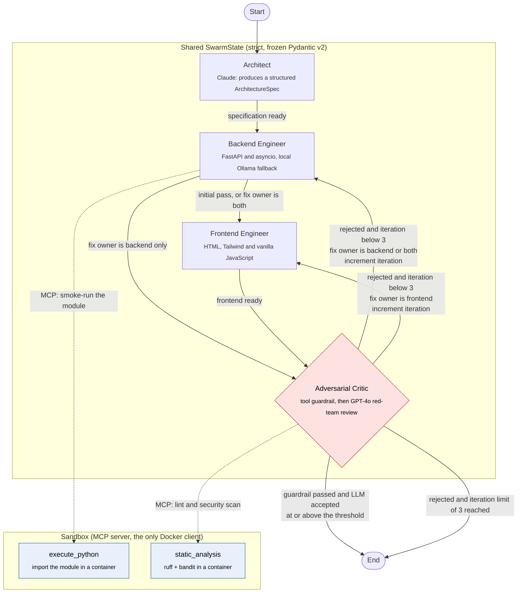
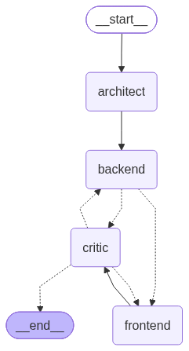

# agentic_swarm

A hierarchical multi-agent system that turns a product requirement into a **typed FastAPI
backend** and a **matching HTML/Tailwind frontend**. An adversarial critic from a *different
model family* reviews the output, and a deterministic self-correction loop sends its feedback
back to the engineer responsible for each problem.

Generated code **never runs on the host**: agents execute and analyse it only through
**Model Context Protocol (MCP)** tools, served by a sandbox server that runs every call in a
throwaway, network-less, read-only, non-root Docker container. Before the critic's LLM review
counts, a **fail-closed guardrail** runs ruff and bandit over the backend and checks that it
imports cleanly; any non-zero tool exit forces another revision, whatever the model's score.

Built on **LangGraph** (`StateGraph`), strict **Pydantic v2** contracts, the **MCP** Python
SDK and **Langfuse** tracing. It passes `ruff check`, `ruff format`, `mypy --strict` and
bandit, and the test suite runs fully offline at 99% branch coverage.

---

## Topology



The diagram above is hand-annotated with the routing conditions and the MCP tool calls. The
image below is rendered directly from the compiled `StateGraph`, so it is exactly what LangGraph
executes (dashed arrows are conditional edges). The sandbox is not a graph node: it is a tool
server the backend and critic nodes call.

<p align="center">
  
</p>

Regenerate it with `uv run --frozen python scripts/export_graph.py --output-dir docs`
(see [Graph export](#graph-export)).

| Node | Role | Default model | Output |
|---|---|---|---|
| `architect` | Breaks the requirement down into data models, endpoints and UI layout | `claude-opus-5-5` (Anthropic) | `ArchitectureSpec` → `architecture_spec` |
| `backend` | Writes one typed FastAPI module, then smoke-runs it via MCP | `claude-sonnet-5`, falls back to `llama3.1:8b` via Ollama | `backend_code`, `backend_execution` |
| `frontend` | Writes one self-contained `index.html` that calls the backend | `claude-sonnet-5`, falls back to `llama3.1:8b` via Ollama | `frontend_code` |
| `critic` | Tool guardrail via MCP, then red-team review of both artifacts | `gpt-4o` (OpenAI or OpenRouter) | `CriticReport` (with `GuardrailReport`) → `eval_report` |

Every role's provider can be swapped independently: `anthropic`, `openai`, `openrouter` or `ollama`.

## Code-execution sandbox (MCP)

The agents hold an MCP client (`McpCodeTools`) and nothing else that can run code. The server,
`src/sandbox/server.py`, exposes two read-only tools and is the **only process that talks to
Docker**:

| Tool | Does | Returns |
|---|---|---|
| `execute_python` | Runs the snippet as module `__sandbox__` (an `if __name__ == "__main__":` block does not run, so a server never starts) | `ExecutionResult`: exit code, capped stdout/stderr, timeout flag, duration |
| `static_analysis` | `ruff check` (rules `E9,F,B,ASYNC`) and `bandit` (medium severity and confidence) over the snippet, in parallel | `StaticAnalysisReport`: one `ToolRun` per analyser with parsed findings |

Every call starts a fresh container from the sandbox image (`docker/sandbox/`), with:

- `--network none`, `--read-only` root filesystem and a 16 MB `noexec` tmpfs at `/tmp`
- `--cap-drop ALL`, `no-new-privileges`, uid/gid `65534` (nobody)
- `--pids-limit 64`, `--memory 256m` (no swap), `--cpus 0.5`, a 20 s wall-clock deadline
  (the container is force-removed on timeout)
- `--pull never`, so only the locally built, hash-locked image can run
- code streamed over **stdin**, never written to the host or passed as an argument; output is
  capped at 64 KiB per stream so a flood cannot exhaust the server's memory

Failures are classified, never guessed. A failing snippet is a *result* (the critic sends it
back for a fix). An unreachable server, a missing daemon or image (checked once by a cached
preflight, because `docker run` exits `1` when the daemon is down, which would look like
failing code) or a malformed tool response raises `SandboxError` and aborts the run with exit
code `2`. Unverified code is never accepted. The stdio server process inherits no provider or
tracing secrets.

Transports: by default (`SWARM_MCP__TRANSPORT=stdio`) the CLI spawns
`python -m src.sandbox.server` as a child process. With `streamable-http` it connects to a
running server, such as the `sandbox-mcp` compose service, which enforces a DNS-rebinding
guard on the `Host` header.

## Design decisions

- **Acceptance is fail-closed.** The critic first builds a `GuardrailReport` from
  `static_analysis` on the backend and the backend's own sandboxed import (`backend_execution`).
  It accepts only if the guardrail passes **and** the LLM accepts at or above
  `SWARM_ACCEPTANCE_THRESHOLD`. Any non-zero tool exit, timeout, unparseable analyser report
  or missing execution forces a revision. No LLM score can override the guardrail.
- **Tool findings lead the feedback.** Guardrail failures come first in `vulnerabilities`
  (`[bandit B602] line 3: …`, `[sandbox] importing the backend module failed (exit 1): …`).
  The critic LLM sees them as authoritative, and the engineer's revision prompt says the
  deterministic gate failed. Because the analysed code is the backend, a frontend-only
  verdict escalates to `both` when the backend fails the gate.
- **Loop control is deterministic and lives in one place.** `CriticAgent.decide()` is a pure
  function of (state, verdict, guardrail): it gates acceptance, picks the fix owner and
  increments `iteration` only when a revision is actually scheduled. The graph routers
  (`route_after_critic`, `route_after_backend`) only read `status` and `revision_target`, so
  you can test them without running a graph.
- **Feedback goes to the engineer who owns the problem.** A backend-only fix skips the
  frontend, which saves tokens and latency. A `both` fix re-runs the backend and then the
  frontend, so the UI tracks any API changes.
- **The critic uses an independent model family.** Code written by Claude is reviewed by
  GPT-4o, which reduces correlated blind spots.
- **Every payload is a strict contract.** State, agent outputs, tool responses and critic
  reports derive from one `Contract` base: `extra="forbid"`, `frozen`, `strict`, collections as
  tuples. Nodes return a typed `NodeUpdate` and never mutate state.
- **Structured output is validated by us, in JSON mode.** The architect and critic request a
  JSON schema (strict decoding on OpenAI) and `parse_structured` validates the reply in strict
  JSON mode: arrays map onto tuples, but `"90"` is not a score and unknown keys are rejected.
  The class is not handed to `with_structured_output`, because the provider parsers validate in
  Python mode, which strict contracts reject.
- **Recursion is bounded.** `recursion_limit = 4 + 3 × max_iterations + 1`, derived from the
  worst-case path.
- **Credentials fail fast.** A missing key raises a clear error before any tokens are spent.
  The CLI returns exit code `2`.

## State schema

```python
class SwarmState(Contract):  # extra="forbid", frozen=True, strict=True
    user_prompt: str  # non-empty
    architecture_spec: ArchitectureSpec | None
    backend_code: str
    backend_execution: ExecutionResult | None  # sandboxed import of backend_code, via MCP
    frontend_code: str
    eval_report: CriticReport | None
    iteration: int  # number of revisions performed (0..max_iterations)
    status: Status  # pending → … → accepted | max_iterations_reached
    revision_target: Literal["backend", "frontend", "both"] | None  # routing bookkeeping


class CriticReport(Contract):  # the gated verdict recorded in state
    is_accepted: bool  # final decision: guardrail AND LLM AND score threshold
    vulnerabilities: tuple[str, ...]  # guardrail failures first, then the LLM's findings
    performance_notes: tuple[str, ...]
    score: int  # 0..100, the LLM's score
    defect_owner: Literal["backend", "frontend", "both"]
    reviewed_iteration: int
    guardrail: GuardrailReport  # StaticAnalysisReport + ExecutionResult | None
```

## Project layout

```
src/
  config.py          pydantic-settings: role routing, loop limits, sandbox + MCP, credentials
  state.py           Contract base, SwarmState, every agent / tool / critic contract
  graph.py           StateGraph wiring + pure routing functions
  tracing.py         Langfuse façade: best effort, bounded flush
  main.py            CLI entrypoint, sandbox session, artifact export
  agents/
    base.py          AgentNode protocol, code-fence extraction, parse_structured, prompts
    llm.py           provider factory (Anthropic / OpenAI / OpenRouter / Ollama + fallback)
    architect.py     Node 1
    backend.py       Node 2: writes the module, smoke-runs it via MCP
    frontend.py      Node 3
    critic.py        Node 4: "Pan Maruda", tool guardrail + loop-control policy
  sandbox/
    base.py          CodeTools protocol, SandboxError
    server.py        MCP server (execute_python, static_analysis); stdio or streamable HTTP
    client.py        McpCodeTools: the agents' MCP client, strict response validation
    docker.py        DockerSandbox: hardened `docker run`, capped I/O, ruff/bandit parsers
docker/sandbox/      sandbox image: CPython + ruff + bandit + FastAPI stack (hash-locked)
Dockerfile           targets: swarm (default, no Docker access) and sandbox-server
docker-compose.yml   swarm ⇄ sandbox-mcp ⇄ private dind daemon
tests/               198 offline tests + 9 opt-in Docker integration tests
```

## Quick start

Requirements: macOS/Linux, [`uv`](https://docs.astral.sh/uv/), [`direnv`](https://direnv.net/)
and a running Docker daemon (for the sandbox only; the agents themselves run on the host).

```bash
cp .env.example .env          # add ANTHROPIC_API_KEY, OPENAI_API_KEY, optional LANGFUSE_*
direnv allow                  # activates .venv, pins every cache and the CPython to the project
uv sync --frozen              # reproducible install from uv.lock

# Build the sandbox image once (and again after editing docker/sandbox/).
docker build -t agentic-swarm-sandbox:local docker/sandbox

uv run --frozen python -m src.main                       # default task: rate-limited URL shortener
uv run --frozen python -m src.main --prompt "Build a token-bucket microservice ..."
```

The CLI starts the MCP sandbox server over stdio, runs the swarm and writes the artifacts to
`output/`: `spec.json`, `backend.py`, `index.html` and `eval_report.json` (which includes the
guardrail's findings).

To try them:

```bash
uv run --frozen --with fastapi --with uvicorn uvicorn output.backend:app --port 8000
open output/index.html
```

Exit codes: `0` accepted · `1` not accepted within the iteration budget · `2` configuration
error or sandbox unavailable (missing key, Docker daemon down, sandbox image not built, MCP
server unreachable).

### Fully containerised (Docker Compose)

```bash
docker compose up -d --wait sandbox-mcp          # private dind daemon + sandbox image + MCP server
docker compose run --rm swarm --prompt "..."     # one swarm run; artifacts land in ./output
docker compose down -v                           # stop and drop dind's image store
```

Trust boundaries in the stack:

- `swarm` runs the agents. It has no Docker CLI and no socket, and it is not on the sandbox
  network: it can only reach code execution through `sandbox-mcp`'s tools.
- `sandbox-mcp` is the MCP server over streamable HTTP on `:8765`. It is never published to
  the host, and it is the only service that talks to a Docker daemon.
- `dind` is that daemon: a private docker-in-docker instance, not the host's. The host socket
  is mounted nowhere. It is `privileged` (inherent to docker-in-docker), but it publishes no
  port and is confined to its own network, and every sandbox it starts still gets the full
  isolation set above.
- Every service except `dind` runs read-only with `cap_drop: [ALL]` and `no-new-privileges`,
  and all images are pinned to exact versions.

### Fully local run (no cloud keys for the engineers)

```bash
ollama pull llama3.1:8b
SWARM_BACKEND__PROVIDER=ollama SWARM_BACKEND__MODEL=llama3.1:8b \
SWARM_FRONTEND__PROVIDER=ollama SWARM_FRONTEND__MODEL=llama3.1:8b \
uv run --frozen python -m src.main
```

With `SWARM_OLLAMA_FALLBACK_ENABLED=true` (the default), an engineer role also falls back to
Ollama at runtime when its primary provider errors, or when that provider's key is missing.
The sandbox image is still required.

## Observability (Langfuse)

Tracing turns on automatically when `LANGFUSE_PUBLIC_KEY` and `LANGFUSE_SECRET_KEY` are set.

- Uses `langfuse.langchain.CallbackHandler`, the Langfuse v3+/v4 location of the handler
  formerly at `langfuse.callback.CallbackHandler`.
- A single trace, `agentic_swarm`, per run. It is grouped under a session id, set with
  `--session-id` or generated.
- Each graph node shows up as a span (`architect`, `backend`, `frontend`, `critic`) with nested
  generations (`architect.spec`, `backend.implement`, …). Each generation carries **token usage**
  and **latency**, and revision passes appear as repeated node spans.
- **Tracing is best effort.** A missing SDK, a bad key, a failing trace context or an
  unreachable collector degrades to an untraced run with a warning, never a failed one. The
  final flush is bounded by `SWARM_TRACING_FLUSH_TIMEOUT_S` (default 5 s), because the exporter
  otherwise blocks on retries when the collector is down.
- End-to-end wall-clock latency is also logged by the CLI.

## Graph export

`scripts/export_graph.py` compiles the real `StateGraph` (with placeholder nodes, so no API
keys are needed) and writes:

- `output/swarm_architecture.mmd`: Mermaid source from `graph.get_graph().draw_mermaid()`
- `output/swarm_architecture.png`: rendered with `graph.get_graph().draw_mermaid_png()`

```bash
uv run --frozen python scripts/export_graph.py                   # both artifacts
uv run --frozen python scripts/export_graph.py --mermaid-only    # offline, .mmd only
uv run --frozen python scripts/export_graph.py --output-dir docs # refresh the committed copy
```

A copy of both files is committed in `docs/` and embedded above. Refresh it whenever the graph
topology changes.

PNG rendering goes through the public mermaid.ink API, so it needs network access and sends
the diagram source (node names only, no code or secrets) to that service. Use
`--mermaid-only` to stay fully offline. The pyppeteer renderer is deliberately not used,
because it downloads Chromium into the home directory.

## Secrets and SSD isolation

API keys live in exactly **one** place: `.env` at the project root, on the external SSD.

| Key | Needed when | Where to get it |
|---|---|---|
| `ANTHROPIC_API_KEY` | any role uses `anthropic` (default: architect, backend, frontend) | console.anthropic.com → API keys |
| `OPENAI_API_KEY` | any role uses `openai` (default: critic) | platform.openai.com → API keys |
| `OPENROUTER_API_KEY` | any role uses `openrouter` | openrouter.ai → Keys |
| `LANGFUSE_PUBLIC_KEY` / `LANGFUSE_SECRET_KEY` | you want tracing | Langfuse project → Settings → API keys |

```bash
cp .env.example .env && chmod 600 .env    # owner-only permissions
git check-ignore -v .env                  # must print the .gitignore rule
```

Why this setup:

- **Not in git history.** `.gitignore` excludes `.env` and `.env.*` (only `.env.example`
  is tracked), plus `*.pem` and `*.key`. Before pushing, `git ls-files | grep -E '\.env$'`
  must print nothing.
- **Not on the internal disk.** Keys are never exported from `~/.zshrc`, `~/.zprofile` or the
  macOS Keychain. direnv (`dotenv_if_exists .env`) and pydantic-settings load them only while
  you are inside this directory, and direnv unloads them when you `cd` out. The SDKs used here
  (Anthropic, OpenAI, Langfuse) keep keys in process memory only and don't write them to disk.
- **Not in caches or logs.** Keys are typed as `SecretStr`, so they print as `**********`
  in reprs and logs. Every cache is pinned under `./.cache/` on the SSD.
- **Not in the sandbox.** The MCP server process inherits only `PATH`, `HOME`, locale,
  `TMPDIR`, `PYTHONPATH`, `VIRTUAL_ENV`, `DOCKER_*` and `SWARM_SANDBOX__*`, and loads only the sandbox section of the
  config. Sandbox containers get no environment from the host at all.
- **Not in container images.** `.dockerignore` is an allow-list (`pyproject.toml`, `uv.lock`,
  `src/`), so `.env` and `.cache/` can never reach a layer. In compose, keys reach only the
  `swarm` service, through `env_file`.
- **Not in traces.** Langfuse records prompts, completions, model parameters, token usage and
  latency. Keys are passed to the SDK clients as `SecretStr` credentials, not as part of any
  prompt, so they aren't sent to Langfuse. Before a demo, check one trace to confirm this.
- **If a key leaks:** rotate it in the provider console first, then clean up.
  Rewriting git history does not un-leak a key that was already pushed.

## Configuration reference

| Variable | Default | Purpose |
|---|---|---|
| `SWARM_<ROLE>__PROVIDER` | see table above | `anthropic` \| `openai` \| `openrouter` \| `ollama` |
| `SWARM_<ROLE>__MODEL` | see table above | model id for the role (`ARCHITECT`, `BACKEND`, `FRONTEND`, `CRITIC`) |
| `SWARM_MAX_ITERATIONS` | `3` | self-correction budget |
| `SWARM_ACCEPTANCE_THRESHOLD` | `80` | minimum critic score for acceptance (the guardrail must also pass) |
| `SWARM_OLLAMA_FALLBACK_ENABLED` | `true` | runtime fallback for engineer nodes |
| `SWARM_OLLAMA_FALLBACK_MODEL` | `llama3.1:8b` | fallback model |
| `SWARM_MCP__TRANSPORT` | `stdio` | `stdio` (spawn the sandbox server) \| `streamable-http` (connect to one) |
| `SWARM_MCP__URL` | `http://127.0.0.1:8765/mcp` | server URL for `streamable-http` |
| `SWARM_MCP__CALL_TIMEOUT_S` | `120` | per-tool-call read timeout |
| `SWARM_SANDBOX__IMAGE` | `agentic-swarm-sandbox:local` | sandbox image (must exist locally: `--pull never`) |
| `SWARM_SANDBOX__TIMEOUT_S` | `20` | wall-clock limit per container |
| `SWARM_SANDBOX__MEMORY` / `__CPUS` / `__PIDS_LIMIT` | `256m` / `0.5` / `64` | container resource limits |
| `SWARM_SANDBOX__RUFF_SELECT` | `["E9","F","B","ASYNC"]` | ruff rules for the guardrail (JSON list) |
| `SWARM_SANDBOX__BANDIT_SEVERITY` / `__BANDIT_CONFIDENCE` | `medium` / `medium` | bandit thresholds (`low` \| `medium` \| `high`) |
| `SWARM_TRACING_FLUSH_TIMEOUT_S` | `5` | upper bound on the final Langfuse flush |
| `ANTHROPIC_API_KEY` / `OPENAI_API_KEY` / `OPENROUTER_API_KEY` | – | provider credentials |
| `LANGFUSE_PUBLIC_KEY` / `LANGFUSE_SECRET_KEY` / `LANGFUSE_BASE_URL` | – | tracing |

## Quality gates

```bash
uv run --frozen ruff format --check .
uv run --frozen ruff check .
uv run --frozen mypy                                   # strict, pydantic plugin, src + tests + scripts
uv run --frozen bandit -c pyproject.toml -r src scripts -q
uv run --frozen pytest --cov                           # offline; branch-coverage floor 95%
```

The tests exercise the real graph and do not call any external API, Docker or Langfuse:

- **Routers and critic policy.** Every `status` × `revision_target` combination; the score gate,
  iteration increment and stop at the limit.
- **Guardrail.** A bandit finding, a non-zero exit without findings, a failed or timed-out
  import, and a missing execution each force a revision even when the LLM scores 100; a
  frontend-only verdict escalates to `both`; persistent tool failures exhaust the budget
  unaccepted; an unreachable sandbox aborts the run instead of being scored.
- **MCP boundary.** The real protocol runs in-process against a fake sandbox: tool listing and
  annotations, strict round trips, server-side input bounds, rogue and malformed servers. One
  test spawns the real stdio server process.
- **Sandbox.** Every isolation flag, code over stdin, unique container names, the daemon
  preflight, timeout cleanup and ruff/bandit parsing, plus the real subprocess runner
  (deadline, output cap, ignored stdin).
- **Contracts.** Every schema is closed, frozen and strict (checked by reflection); coercion and
  unknown keys are rejected; LLM-facing schemas satisfy OpenAI strict mode.
- **Containers.** The Dockerfiles and compose file as written: no host socket, only `dind`
  privileged, no published ports, a non-root user in every runtime stage, exact image pins,
  and names that agree across files.
- **Tracing, attribution and entrypoints.** Every Langfuse failure degrades gracefully; every
  git-hook rejection path; the CLI's artifacts and exit codes.

`tests/test_sandbox_integration.py` proves the isolation on a real daemon (no network,
read-only rootfs, uid 65534 with no effective capabilities, timeout kill and cleanup, real
ruff and bandit, the MCP stdio path end to end). It is opt-in:

```bash
docker build -t agentic-swarm-sandbox:local docker/sandbox
SWARM_DOCKER_TESTS=1 uv run --frozen pytest -m docker
```

CI (`.github/workflows/ci.yml`, actions pinned by SHA) runs three jobs on every push and pull
request: the git attribution audit, the gates above plus `uv lock --check`, and an image job
that builds all three images, probes them (non-root, Docker CLI only in `sandbox-server`,
read-only code) and runs the Docker integration tests.

## Contributing

Commits follow Conventional Commits, one logical change each, with the gates green before every
commit. Authorship is enforced by versioned git hooks in `.githooks/` (installed by `.envrc`)
and re-checked in CI; see `CLAUDE.md` for the full invariant.

## Storage hygiene (external-SSD isolation)

All state stays under the project root on the external volume. `.envrc` pins
`UV_PROJECT_ENVIRONMENT`, `UV_CACHE_DIR` (with `UV_LINK_MODE=copy` for a cross-volume cache), the
uv-managed CPython (`UV_PYTHON_INSTALL_DIR` with `UV_PYTHON_PREFERENCE=only-managed`), the uv
tool directories, `HF_HOME`, `TORCH_HOME`, `XDG_CACHE_HOME`, the ruff, mypy, pytest, coverage and
tiktoken caches, and `TMPDIR`, all under `./.cache/`. It also sets `PYTHONDONTWRITEBYTECODE=1`.

`layout uv` is defined inline in `.envrc`, because some direnv releases don't ship it and a
global `direnvrc` would live on the internal disk. The only exception is `direnv allow`, which
records an approval hash in direnv's own data directory.

Docker images are the other exception: Docker Desktop keeps images in its own disk image, which
by default is on the internal disk, so building the sandbox image writes its layers there. Move Docker Desktop's disk image to the SSD (Settings → Resources → Advanced) to keep
everything on the external volume.
